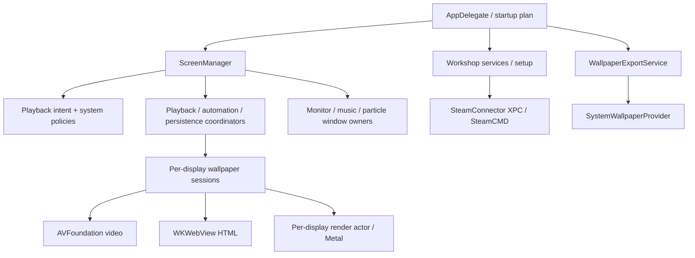
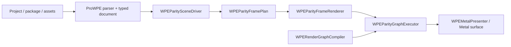

# Architecture

**English** · [简体中文](../zh-Hans/architecture.md)

Loomscreen is a local macOS application. SwiftUI provides the settings and
library UI, AppKit owns desktop windows, and AVFoundation, WKWebView and Metal
provide the three wallpaper runtime paths. There is no application server.
Optional network clients serve Workshop, weather, artwork/lyrics and updates.

## Targets and packages

| Component | Responsibility |
|---|---|
| `LiveWallpaper` / `LiveWallpaperLite` | Pro and Lite app targets; startup, UI, sessions, policies, persistence adapters and platform services |
| `Packages/LiveWallpaperCore` | Shared schemas, capability catalog, playback state machine, persistence utilities and SwiftUI design system |
| `Packages/LiveWallpaperProWPE` | WPE package/scene/model parsing and typed schema; depends on Core |
| `SteamConnector` | Pro's XPC service; SteamCMD discovery, verification, sign-in and library operations outside the host app sandbox |
| `SystemWallpaperProvider` | macOS wallpaper extension; serves published videos and Pro live scenes independently of the app |

Core contains shared UI as well as data/runtime contracts; it is not a UI-free
domain package. The WPE Metal renderer is in the app target's `Runtime/Metal`,
not in ProWPE. There is no separate SharedUI or VideoWeb package.

Lite compiles app sources with `LITE_BUILD` and does not link the ProWPE
product. Xcode app conditions do not propagate into Swift packages.
`ProductCapabilities` and `FeatureCatalog` expose the runtime capability set;
the app adds Workshop capability for Pro at startup. Missing catalog injection
is featureless, rather than defaulting to Pro.

## App and session ownership

- `LiveWallpaper/App/LiveWallpaperApp.swift` constructs app-lifetime services,
  hosts the management window and its floating tour, and coordinates startup and termination.
- `LiveWallpaper/App/ScreenManager.swift` and its extensions manage display
  identity, configuration, policy and runtime reconciliation. The class delegates
  playback transitions, automation and persistence to dedicated coordinators.
- `LiveWallpaper/Runtime/Session/` owns preparation, activation, pause,
  hibernation and teardown for video, HTML and scene sessions.
- User intent lives in a per-screen `WallpaperPlaybackStateMachine`. Policy
  can suspend rendering without rewriting the user's play/pause choice.
  Transition/configuration generations reject obsolete asynchronous results.
- Monitor, music and particles have separate window owners and per-display
  settings. Sharing a display does not make them part of the wallpaper decoder.

## Management workspace

`SettingsWindowHost` always hosts `EditDeskRoot`; the old UI switch is retired.
`EditDeskRouter` owns page/display navigation. The root owns window-scoped
library filters, Workshop browsing, guidance, toasts and undo history.

`HomePage` connects SwiftUI controls to the AppKit/CALayer stage through
`EditDeskStageModel`. Overview, shelf and expanded library share the stage's
progress model; display detail is coordinated by `DisplayDetailHost`.
Wallpaper applies go through `ApplyRouter`, with per-display cancellation and
an explicit applied/failure outcome. Covers use captures/caches rather than
creating a second live wallpaper session.

`OverlayEditorSession` connects the common widget/music/clock canvas to product
setters. Editor composition does not merge their runtime window owners.
Settings remains a grouped, searchable sidebar inside the same management
window. The Welcome Tour and page guides are overlays, not separate onboarding
windows. See [Workspace](workspace.md) for the user workflow.

## Product commands and file layout

`Application/Configuration/DisplayConfigurationController.swift` is the shared
product commit entry for display configuration. UI and playback callers delegate
manual schedule holds, scene-edit invalidation, bookmark-name priming, storage
mutation and change notifications to it. `WallpaperConfigurationStore` remains
the configuration read/revision store; this controller does not add another cache.

`Application/Workshop/` contains download, folder-import and repository-mutation
coordinators. `Infrastructure/Workshop/` keeps HTTP, cache, SteamCMD/XPC and asset
services. These are folders inside the existing app target, not new packages;
Pro-only files retain their `LITE_BUILD` guards.

The `ScreenManager` extension files follow the call boundary: `+Wallpaper`
contains content-selection commands, `+AmbientActivation` prepares HTML/scene
sessions, and `+AmbientTransaction` commits the prepared replacement. `+Overlays`
handles desktop overlay settings and visibility; `+SourceAccess` propagates
refreshed resource grants through configurations, history, bookmarks and schemes.
All remain parts of the same app-lifetime owner; the split adds no runtime state.

## WPE render pipeline

The app resolves primary, dependency and engine-asset roots under their file
access grants. `Runtime/Metal/Parity/` owns scene preparation, shader binding,
resource loading and frame execution. ProWPE supplies the typed scene, script,
text, particle, HLSL and render-graph contracts. The app's `wpe-shaderc` helper
uses DXC and Metal Shader Converter to build cached shader artifacts.
The frame path combines script state, audio, pointer input, dynamic textures,
text and particles before executing the compiled passes.

This is the sole WPE scene renderer. The previous renderer and its selection
and fallback modes have been retired. A failed replacement load keeps the
previous wallpaper where available and reports the failure; it does not
instantiate an older rendering backend. Presentation, MetalFX, capture,
audio/video decoding and resource-access infrastructure remain shared.

`Runtime/Metal/RenderThread/WPEDisplayRenderActor.swift` owns its renderer in a
serial isolation domain. It supports a dedicated render-thread executor and a
main-executor backing. Configuration commands pass through a FIFO stream;
frame readiness and generations guard load/reload/teardown boundaries.
Frame inputs, prepared scene data, resource bindings and texture/target caches
belong to this pipeline and its shared presentation infrastructure.

Compatibility tests and local Metal traces validate specific paths. They do
not establish full Windows parity. Shader, blend, particle and attachment
semantics need reference/Windows evidence when changed; do not infer WPE
behavior solely from this renderer's comments. Pixel equality is not the
acceptance criterion for random effects or font rendering.

## Persistence and background work

Configuration uses JSON, UserDefaults and security-scoped bookmarks. Core owns
data models and serialization utilities; app adapters connect them to settings,
bookmarks, schemes and runtime changes. `.lwconfig` stores settings and
references, not a portable copy of wallpaper media or secrets.

Storage inventory resolves roots and holds scopes on MainActor, then scans via
`WPEStorageInventoryScanner`. The scan checks cancellation and per-root work
budgets; the settings UI accepts only the newest generation. This boundary is
already implemented, rather than a planned migration off the UI actor.

Monitor data sources publish snapshots into shared history. Views distinguish
missing measurements from zero; network/disk accumulated values are estimates.
Now Playing metadata, artwork and playhead work follow source demand and track
identity. Preview data uses existing snapshots/caches instead of creating a
second wallpaper session.

## External execution and secrets

The app remains sandboxed. Pro uses the existing unsandboxed SteamConnector
XPC service for SteamCMD; a helper receipt is not a file-access grant. Before
import, the app locates the requested item in the authorized Steam library and
revalidates that folder. App-managed repository mutations coordinate downloads
and deletion, but do not lock out an independently running Steam client.

New Steam API keys go to the login Keychain. Legacy file migration is retained
for older installations. In-app sign-in passes credentials through XPC to the
SteamCMD terminal input; Loomscreen does not save the password/Guard code or
place it in command arguments or logs. SteamCMD manages cached login state.
Sign-in and account snapshots use an advisory lock on each private account
profile. Up to three downloads run in isolated worker profiles; publication
serializes shared content and merges only each item's ledger records.
A SteamCMD started in Terminal, including the sign-in command shown under
Diagnostics, does not take the account lock, so the in-app sign-in form is the
supported path.

HTML has separate local-file and remote/network policy boundaries. Diagnostics
are local and redacted; online requests still exist for enabled features.
Details: [Security](../SECURITY.md).

## System Wallpaper provider

On macOS 26+, `WallpaperExportService` copies videos, records scene/web loops,
and stages self-contained live scene bundles for `SystemWallpaperProvider`.
Scene recording and live playback share the parity renderer and a
bounded IOSurface buffer pool; web recording uses ScreenCaptureKit's window
capture rather than WebKit snapshots. The extension renders independently
of the app, publishes a heartbeat, and performs compatibility checks. macOS
chooses the active wallpaper; the app's library status is not an authoritative
view of every system-side state.

The provider uses private wallpaper/XPC integration bridges contained in
`SystemWallpaperProvider/`. Treat it as a version-sensitive platform boundary,
not a public general-purpose wallpaper SDK. Pro shares its WPE scene runtime
with the extension; it does not host live HTML or the app's overlay windows.
Live scene time/date updates remain active at one frame per second when desktop
animation is paused. Hidden/sleeping scenes can hibernate. An incompatible provider can disable its
own path without replacing the normal app wallpaper architecture.

The app prepares shader artifacts and freezes the compiler identity and render
settings in the published scene capsule. The extension consumes that prebuilt
cache without shipping the shader compiler. A missing or incompatible artifact
fails explicitly and can retain the poster; there is no legacy-renderer fallback.

The selected item and per-display targets use the existing provider manifest.
Published media, scene bundles and display targets are installation-local and
are not carried by `.lwconfig`: media and macOS wallpaper choices must be
prepared/selected on the destination Mac. Existing app wallpaper settings and
source references retain their normal backup behavior.

## Design and verification

Shared components and tokens live under Core's `UI/`; the contract is
[DESIGN.md](../../Packages/LiveWallpaperCore/DESIGN.md). User-facing changes
preserve five-language coverage and accessibility behavior.

`make verify` orders structure/localization, tooling contracts, changed-line
lint, package tests, the app contract shard and signed WPE/transition Metal suites.
The complete signed Pro suite and Lite/archive release checks are separate, broader gates. A passing shard
is not a full application run. See [Building](building.md) and
[Releasing](releasing.md) for exact commands.
